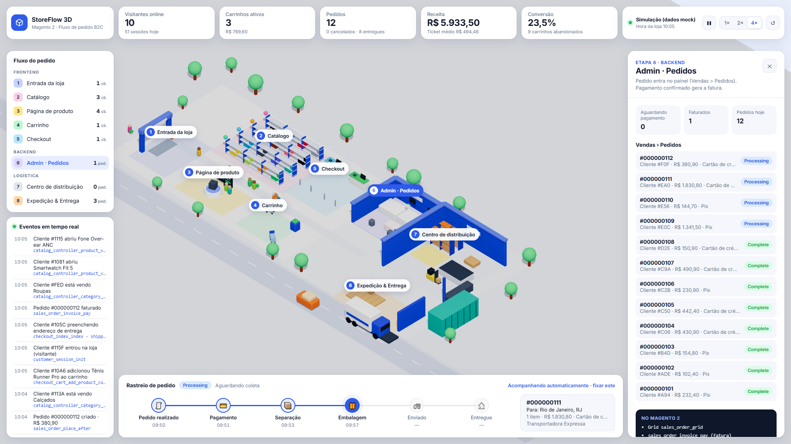

# Agentic Toolkit

Dashboard **somente leitura** para entender qualquer instalação **Magento 2 / Adobe Commerce** lendo o código. Você conecta uma instalação (pasta local, repositório Git, inclusive privado, ou .zip) e ganha:

- **Visão geral:**
  - versão e status de suporte;
  - módulos core, customizados e de terceiros;
  - extensões, Quality Patches, security package, 2FA/reCAPTCHA, tema e stack;
  - highlights técnicos detectados automaticamente.
- **Mapa de integrações:** todas as APIs REST/GraphQL, plugins, preferences, observers, rotas, crons e filas, classificados por etapa do fluxo de compra.
- **Debug de fluxo:** simula um pedido do início ao fim e mostra, em ordem de execução, cada plugin `before/around/after`, preference, evento e observer que roda, nativo e customizado.
- **Fluxo 3D:** a loja em formato de jogo, com a simulação do pedido B2C nativo.
- **Pergunte ao código:** IA (Claude Code local, API da Anthropic ou modelo local) que responde lendo o código, com ferramentas que só leem.
- **Explorador de código no estilo PhpStorm:** tema Darcula, abas, Find in Files, Go to File/Class, Search Everywhere e `Ctrl+clique` para ir à declaração, tudo somente leitura.
- **Pontos de atenção, segurança e patches.**

Feito para o engenheiro que chega num projeto sem contexto e precisa, em minutos, saber o que foi customizado, onde, e o que merece cuidado.



## Navegação de código (atalhos do PhpStorm)

Disponíveis em qualquer tela da instalação:

| Atalho | PhpStorm | O que faz |
|---|---|---|
| `Shift` `Shift` | Search Everywhere | Classes e arquivos juntos |
| `Alt+N` | Go to Class (`Ctrl+N`) | Busca por nome de classe; camel case funciona (`QuPl` → QuotePlugin) e `\` busca pelo namespace |
| `Alt+Shift+N` | Go to File (`Ctrl+Shift+N`) | Busca por nome de arquivo ou caminho; `Arquivo.php:30` abre na linha 30 |
| `Ctrl+Shift+F` ou `Alt+F` | Find in Files | Busca no projeto com diferenciar maiúsculas (`Alt+C`), palavra inteira (`Alt+W`), regex (`Alt+X`), escopo e máscara de arquivo, com pré-visualização |
| `Ctrl+F` / `Ctrl+G` | Find / Go to Line | Dentro do arquivo aberto |
| `Ctrl+clique` | Go to Declaration | Abre a classe sob o cursor (resolve `use` e namespace); classes do core abrem no GitHub na tag da sua versão |

O Chrome reserva `Ctrl+N` e `Ctrl+Shift+N` (nova janela e janela anônima), e nenhuma página consegue capturá-los. Por isso as variantes com `Alt`. Tudo isso é feito pela aplicação, com índice e busca locais, sem IA e sem custo. O código é colorido pelo CodeMirror 6 (PHP, phtml, XML, JS, LESS/CSS, JSON e YAML).

## Simulador de API

Em **Ferramentas & plugins → Simulador de API** (ou no botão "Testar no simulador" no detalhe de uma rota REST ou GraphQL) você testa os endpoints da instalação contra um ambiente seu, como no Postman:

- **Campos já preenchidos**: método, caminho, parâmetros de caminho e query (`searchCriteria` nos `GET` de listagem). O body JSON é montado a partir da assinatura PHP do método de serviço e dos getters das Data Interfaces, com os nomes de campo que o Magento espera. Parâmetros que o `webapi.xml` preenche pelo token (ex.: `cartId` nas rotas `/mine`) ficam de fora.
- **Autorização igual ao Postman**: um select com Sem autenticação, Bearer token, Admin (usuário e senha), Cliente (e-mail e senha) e Basic Auth. Admin e Cliente têm "Gerar token", que chama `/V1/integration/{admin|customer}/token` no ambiente e aplica o token. A autorização sugerida vem da ACL da rota.
- **Resposta**: status, tempo, tamanho, body formatado e headers. "Copiar como cURL" mascara o token, a menos que você marque "incluir token real".

O simulador só envia a requisição. Se o ambiente está de pé ou não é com você: quando ele não responde, aparece o motivo (conexão recusada, DNS, certificado). A URL base e o store code ficam salvos no navegador, por instalação. Senhas e tokens ficam só na memória da aba e nunca vão para disco nem para a auditoria, que registra apenas o método e a URL de destino. Antes de um `POST`/`PUT`/`DELETE` para um host que não parece local, o Agentic Toolkit pede confirmação.

## Documentação

Em **Ferramentas & plugins → Documentação** o seu Claude Code escreve uma documentação estruturada a partir do código da instalação. Você escolhe o tipo e o assunto:

| Tipo | Exemplo | O que a doc cobre |
|---|---|---|
| Módulo | `Vendor_Checkout` | Arquivos, APIs, plugins, observers, configuração e dados do módulo |
| Funcionalidade | estorno parcial de pedido | Como funciona de ponta a ponta, em todos os módulos envolvidos |
| Fluxo | do carrinho até o pedido | A ordem real de execução: entrada, serviços, plugins, observers, persistência |
| Tema | integrações com o ERP | Todos os pontos do código ligados ao assunto e como se conectam |

Toda doc segue a mesma estrutura: resumo, visão geral, onde está no código, como funciona, pontos de extensão, configuração, dados, dependências, riscos, como testar e referências com `arquivo:linha`. Durante a geração aparece o que o Claude está lendo; no fim, a lista de arquivos consultados abre no explorador de código.

- **Preview no Claude Docs**: ao terminar, a doc é publicada automaticamente no Claude Docs da sua conta claude.ai (privada até você compartilhar) e o link aparece no topo. "Regerar" abre o formulário preenchido para você ajustar e atualiza o mesmo documento.
- **Cancelar**: durante a geração ou a publicação, "Cancelar" interrompe o Claude Code.
- **Word e PDF**: gerados localmente pelo Agentic Toolkit, sem depender da publicação.

Precisa do Claude Code instalado e logado (o mesmo de "Pergunte ao código"). A publicação usa o conector Claude Docs da sua conta.

## OpenSpec (desenvolvimento guiado por especificações)

Em **Ferramentas & plugins → OpenSpec** você acompanha as specs e as mudanças do projeto, com o [OpenSpec](https://github.com/Fission-AI/OpenSpec) como fonte da verdade:

- **Visão geral**: contadores (specs, requisitos, cenários, mudanças ativas, arquivadas, progresso das tarefas e problemas de validação), o fluxo das mudanças e a lista de specs com seus status.
- **Quadro (Kanban)**: colunas Planejamento, Em andamento, Em revisão, Impedida, Pronta p/ arquivar e Arquivada. Cada card abre a proposta, as tarefas marcadas, as specs alteradas e a validação.
- **Specs**: status (estável, em alteração, rascunho, aprovada, obsoleta) e requisitos com cenários.
- **Primeiro uso**: se o projeto ainda não tem OpenSpec, o painel gera o prompt de instalação para você colar no Claude Code no terminal. Se o OpenSpec estiver em outra pasta, você a mapeia informando o caminho relativo à raiz.

**Somente leitura, também aqui.** O painel lê o `openspec/` do projeto e nunca escreve nele. Instalar (`openspec init`), criar mudanças, implementar e arquivar são prompts para o seu Claude Code no terminal: o painel só copia o texto. O CLI, quando instalado, roda só com verbos de leitura (`list`, `show`, `status`, `validate`), e comandos que escrevem são recusados pela allowlist. Os status manuais (em revisão, impedida, aprovada etc.) ficam no `~/.agentic-toolkit` desta máquina, e não são compartilhados com o time ainda.

## Diagramas de arquitetura

Em **Ferramentas & plugins → Diagramas de arquitetura** você desenha modelos de duas formas, com salvamento automático:

- **Canvas (visual)**, para **C4** e **fluxos**: arraste elementos da paleta, ligue-os pelas alças, edite título, tecnologia e descrição no painel, coloque elementos dentro de fronteiras arrastando-os para elas, e desfaça com Ctrl+Z. Os modelos de referência Magento 2 abrem neste modo.
- **Código (Mermaid)**, para **UML** (classes, sequência, estados) e **entidades (ER)**, e para quem prefere escrever. Diagramas em código de C4 e fluxo podem ser convertidos para o canvas com um botão.
- **Criar com o Claude** gera o modelo a partir da sua descrição: em C4 e fluxo já sai como canvas editável.
- **Código gerado**: no canvas, "Ver código Mermaid" mostra o código correspondente, somente para leitura.
- **Arquiteturas de referência Magento 2**: B2C, B2B, D2C e Marketplace, para editar a partir delas.
- **Criar com o Claude**: descreva a arquitetura e escolha o cenário e o tipo de modelo. O seu Claude Code lê o código desta instalação (somente leitura) e desenha o modelo com os nomes reais de módulos e integrações. Dá para cancelar durante a geração.
- **Exportar**: SVG (vetorial), PNG (para colar em documentos), `.mmd` (código Mermaid) e `.json` do Agentic Toolkit (preserva nome e tipo).
- **Importar**: `.json` do Agentic Toolkit, `.mmd` / `.mermaid` / `.txt` ou um Markdown com um bloco ```` ```mermaid ````.

Os diagramas ficam em `~/.agentic-toolkit`, por instalação, como os quadros e as documentações. O Mermaid carrega só quando você abre a tela, e funciona sem internet.

## Quadro branco

Em **Ferramentas & plugins → Quadro branco** você rascunha fluxos, arquiteturas e ideias com o [Excalidraw](https://github.com/excalidraw/excalidraw) embutido: desenho livre, formas, setas, texto, imagens coladas, biblioteca de formas e exportação em PNG, SVG ou `.excalidraw`.

Cada instalação tem os seus quadros, salvos automaticamente em `~/.agentic-toolkit` (nunca no repositório). Fontes e traduções do Excalidraw são servidas pelo próprio Agentic Toolkit, então o quadro funciona sem internet.

## Regra crítica: somente leitura

O Agentic Toolkit **nunca escreve no código Magento**, e isso é garantido por código, não só por convenção:

| Proteção | Como |
|---|---|
| Toda rota declara uma ação | Rota sem `@Action` é bloqueada (fail closed). Cada ação tem método HTTP permitido e validador próprio, executado antes do handler. |
| Camada de leitura única | O acesso ao código passa por `ReadOnlyFs`, que não tem métodos de escrita e bloqueia `../`, caminhos absolutos e links simbólicos que apontam para fora. |
| Credenciais nunca lidas | `app/etc/env.php`, `auth.json`, `.env`, chaves e `.git/config` são listados, mas o conteúdo é recusado (inclusive para a IA). |
| Escrita só no diretório de dados | Mapas, anotações, clones e uploads ficam em `~/.agentic-toolkit`. Destino dentro de uma instalação Magento é bloqueado. |
| Comandos com allowlist | Git só lê ou clona no diretório de dados (push desativado no clone). Só os scripts do analyzer rodam. O Claude Code roda com `--tools Read,Grep,Glob`, sem MCP e ignorando o `.claude/` do repositório Magento. |
| Simulador de API não toca no repositório | As requisições vão só para a URL que você informou (http/https, sem credenciais na URL, nunca para o próprio Agentic Toolkit), classificadas como "requisição externa" na auditoria. |
| Documentação em duas etapas isoladas | Quem escreve é o Claude Code com `--tools Read,Grep,Glob`, sem MCP. Quem publica é outra execução, sem nenhuma ferramenta de leitura de código, rodando numa pasta do diretório de dados e liberada só para o conector Claude Docs (sem excluir). Ela recebe apenas o Markdown pronto. |
| Auditoria e autoteste | Toda ação (permitida ou bloqueada) vai para o log. A tela "Regras & auditoria" roda um autoteste de cada proteção. |

Os testes automatizados (`npm test`) cobrem essas regras.

### Exceções de escrita (lista explícita)

Há uma única exceção, para o **OpenSpec**, porque criar e editar specs é o objetivo da funcionalidade. Ela está declarada em `apps/api/src/readonly/repo-exceptions.ts` e vale só para estes caminhos, relativos à raiz da instalação:

| Exceção | Caminhos | Extensões |
|---|---|---|
| `openspec` | a pasta do OpenSpec (`openspec/` ou a pasta mapeada): specs, mudanças, tarefas, `config.yaml` | `.md`, `.yaml`, `.yml`, `.gitkeep` |
| `openspec` | `.claude/commands/opsx/*.md` e `.claude/skills/openspec-*/SKILL.md`, instalados pelo `openspec init` | `.md` |

Para gravar, todo caminho passa por estas checagens, e qualquer falha bloqueia a escrita:
- o caminho precisa estar dentro de uma exceção listada, sem `..`, caminho absoluto ou link simbólico;
- arquivos de credenciais continuam bloqueados, mesmo dentro de uma exceção;
- o tamanho é limitado a 512 KB;
- edições carregam a versão (sha) que você abriu, e uma versão mais antiga é recusada, para não sobrescrever outra alteração;
- toda gravação é confirmada na tela (a instalação mostra a lista antes) e registrada na auditoria como "exceção de escrita".

A gravação passa sempre pelo `RepoWriter`, o único lugar do código que escreve em uma instalação. A instalação do OpenSpec roda o CLI numa pasta de preparação dentro do `~/.agentic-toolkit`, e só os arquivos da lista são copiados para a instalação. Os rascunhos do Claude são somente texto, e nada é salvo sem a sua confirmação.

Para liberar outra escrita, é preciso incluir uma nova exceção nessa lista e nos testes, e isso é uma decisão do time.

## Instalação com o Claude Code (recomendado)

Pré-requisitos:
- [Claude Code](https://claude.com/claude-code) (terminal, app desktop ou extensão do VS Code/JetBrains);
- **Node.js 20+** e **git**;
- o código de uma instalação Magento 2 acessível pela máquina (pasta, repositório ou .zip). `vendor/` e banco de dados não são necessários.

Abra o Claude Code na pasta onde quer instalar e cole:

```text
Instale o Agentic Toolkit para mim seguindo o README de https://github.com/commercesimplifyshop-commits/magento-flow-3d.

1. Clone o repositório na pasta atual (se ainda não existir), entre nele e rode `npm install` e `npm run build`.
2. Suba o servidor com `npm start` em segundo plano e confirme que http://127.0.0.1:4310/api/system/health responde.
3. Rode `curl -s http://127.0.0.1:4310/api/system/selftest` e me mostre se todas as proteções de somente leitura passaram.
4. Me pergunte onde está a minha instalação Magento: caminho de uma pasta local, URL de um repositório Git ou um arquivo .zip.
   - Pasta local: valide com POST /api/workspaces/inspect {"path": "<caminho>"} e me mostre o checklist. Se o Magento estiver numa subpasta, use a candidata encontrada. Depois crie com POST /api/workspaces {"source":"local","path":"<raiz>"}.
   - Repositório Git: explique as 3 formas de acesso a repositório privado da seção "Repositórios privados" do README e use a que eu escolher. Nunca grave o token em arquivo nem o mostre nos logs.
   - .zip: me diga para usar a aba "Arquivo .zip" no navegador.
5. Liste os vendors de app/code da instalação, me pergunte quais são do meu time e salve com PUT /api/workspaces/<id> {"ownVendors": [...]}.
6. Rode a análise (POST /api/workspaces/<id>/analysis), acompanhe o job até terminar e me mostre os highlights de GET /api/workspaces/<id>/overview.
7. Abra http://127.0.0.1:4310 no navegador e me explique em poucas linhas as áreas do menu lateral.

Regras: o Agentic Toolkit é somente leitura. Não edite, mova ou apague nada dentro da instalação Magento e não faça commit de nada do diretório ~/.agentic-toolkit.
```

Depois, para a IA analisar as customizações com profundidade (resumos e pontos de atenção), rode dentro do repositório do Agentic Toolkit:

```text
/magento-map <id-da-instalação>
```

## Instalação manual

```bash
git clone https://github.com/commercesimplifyshop-commits/magento-flow-3d.git agentic-toolkit
cd agentic-toolkit
npm install
npm run build
npm start          # http://127.0.0.1:4310
```

Para desenvolvimento: `npm run dev` (API em :4310 com watch + Vite em http://localhost:5173 com proxy para a API).

Variáveis opcionais:

| Variável | Padrão | Para quê |
|---|---|---|
| `AGENTIC_TOOLKIT_DATA` | `~/.agentic-toolkit` | Onde ficam clones, uploads, mapas, anotações, configurações e log de auditoria |
| `AGENTIC_TOOLKIT_PORT` / `AGENTIC_TOOLKIT_HOST` | `4310` / `127.0.0.1` | Porta e interface. Mantenha em localhost: o servidor lê código-fonte. |
| `ANTHROPIC_API_KEY` | — | Para o provedor "API da Anthropic" |
| `AGENTIC_TOOLKIT_CLAUDE_BIN` | detectado | Caminho do executável do Claude Code, se não estiver no PATH |

## Repositórios privados

Na tela "Conectar", aba "Repositório Git", há três formas de acesso:

1. **Git já configurado na máquina (recomendado).** Se você consegue rodar `git clone` do repositório no terminal (chave SSH, agente SSH ou Git Credential Manager), o Agentic Toolkit usa o mesmo acesso. Nenhum segredo passa pelo app.
2. **Token somente leitura.** Ele é usado só no clone ou no fetch, viaja num header HTTP passado por variável de ambiente do git, e nunca vai para a URL, o `.git/config` ou o disco.
   - **GitHub:** fine-grained token → só o repositório → *Contents: Read-only*.
   - **GitLab:** project access token, role Reporter, escopo `read_repository`.
   - **Bitbucket:** repository access token com *Repositories: Read*.
   - **Azure DevOps:** PAT com *Code: Read*.
3. **Deploy key SSH somente leitura.** Uma chave dedicada, cadastrada no repositório sem permissão de escrita. Informe o caminho da chave privada.

O clone é superficial (`--depth 1`), fica em `~/.agentic-toolkit/repos`, com `core.symlinks=false` e push desativado. "Buscar atualizações" faz só `git fetch`.

## Inteligência artificial

Em **Configurações**, escolha o provedor de "Pergunte ao código":

| Provedor | Como funciona |
|---|---|
| **Claude Code local** (padrão) | Usa a sua sessão do Claude Code. Roda dentro da instalação com `--tools Read,Grep,Glob`, `--disallowedTools Edit,Write,Bash,…`, `--setting-sources user` e `--strict-mcp-config`, com leitura do mapa via `--add-dir` (só o diretório de dados). |
| **API da Anthropic** | `claude-opus-5-5`, num loop com ferramentas próprias que só leem: `list_dir`, `read_file`, `grep` e `search_map`. A chave fica só em memória (ou em `ANTHROPIC_API_KEY`). |
| **Modelo local / compatível com OpenAI** | Ollama, LM Studio, vLLM… com as mesmas ferramentas. O modelo precisa suportar tool calling. |

## Compartilhando com o time

Cada engenheiro roda o Agentic Toolkit na própria máquina e conecta o projeto em que trabalha. Nada é enviado para fora, exceto as perguntas à IA para o provedor escolhido. Para levar a análise de um colega:
- copie a pasta `~/.agentic-toolkit/workspaces/<id>/maps` dele;
- ou rode `/magento-map` de novo.

As anotações nunca devem ir para o git do Agentic Toolkit: contêm detalhes do código do cliente.

## Arquitetura

```
apps/api            NestJS: workspaces, análise, visão geral, arquivos, IA, regras de somente leitura
  src/readonly      path-guard, ReadOnlyFs, CommandRunner (allowlist), ações + guarda global, auditoria
apps/web            React + Vite: dashboard (src/shell) e o fluxo 3D / debug (React Three Fiber)
packages/analyzer   extrator estático (webapi.xml, di.xml, events.xml, routes.xml, crontab.xml…) e referência do core
.claude/skills      /magento-map: análise das customizações pelo Claude
```

Como o debug calcula a ordem de execução sem a loja rodando:
- **Plugins:** o mesmo algoritmo do `PluginListGenerator`/`Interceptor` do framework. Sem `sortOrder` = `PHP_INT_MIN`; o `around` abre um novo nível.
- **Observers:** escopo global e depois a área, na ordem de `app/etc/config.php`.
- **Base:** um roteiro nativo conferido no código do core 2.4 (`apps/web/src/debug/scenario.ts`).

Para listar o que é nativo mesmo sem `vendor/`, o Agentic Toolkit baixa da tag pública `magento/magento2` correspondente só os XMLs e as classes de plugin.

**Limites:** é análise estática. Ficam de fora:
- eventos disparados dentro de código customizado;
- chamadas do JavaScript do tema;
- configurações que estão no banco.

Os módulos exclusivos do Adobe Commerce e o MSI não estão na referência pública do core.

## Desenvolvimento

```bash
npm run dev     # API (watch) + web (Vite)
npm test        # testes das regras de somente leitura e do detector Magento
npm run build   # build de produção (API + web)
```

Novas funcionalidades entram no menu lateral em `apps/web/src/shell/Layout.tsx`. Toda rota nova da API precisa declarar uma ação em `apps/api/src/readonly/actions.ts`; sem isso, ela é bloqueada.
